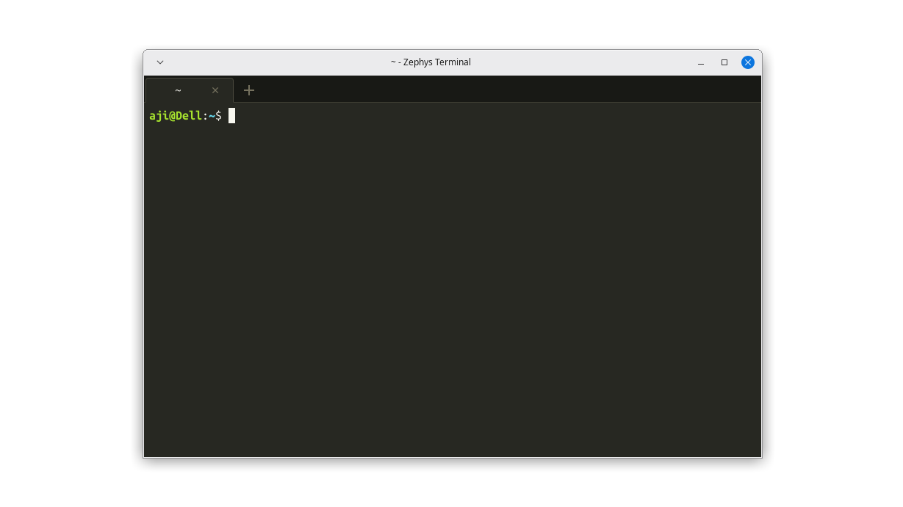

# Zephys Terminal

Clean terminal emulator written in C99, GTK3, and VTE. Designed to be lightweight (around 15-20 MB RAM) with a workflow similar to XFCE Terminal.



## Features

- Built-in Monokai theme (dark and light variants)
- Preferences dialog to adjust font, theme, opacity, and cursor shape
- Tab bar with an inline new-tab button, per-tab close buttons, and middle-click tab closing
- Tabs open in the current tab working directory
- Shortcuts to switch tabs directly (`Alt+1` to `Alt+9`) or cycle through tabs (`Ctrl+PageUp` / `PageDown`)
- Word deletion shortcuts (`Shift+Backspace` deletes backward, `Shift+Delete` deletes forward)
- Word navigation with `Ctrl+Left` and `Ctrl+Right`
- File manager integration: open the active working directory via `Ctrl+Shift+O` or context menu
- Automatic URL detection (`Ctrl+click` to open links in a browser)
- Plain text configuration in `~/.config/zephys/config.ini`

## Shortcuts and controls

| Shortcut | Action |
| :--- | :--- |
| `Ctrl + ,` / `Ctrl + Shift + P` | Preferences dialog |
| `Shift + Backspace` / `Ctrl + Backspace` | Delete word backward (`^W`) |
| `Shift + Delete` / `Ctrl + Delete` | Delete word forward (`Alt+D`) |
| `Ctrl + Left` / `Ctrl + Right` | Move cursor by word |
| `Ctrl + Shift + O` | Open working directory in file manager |
| `Ctrl + Shift + T` | Open new tab |
| `Ctrl + Shift + W` | Close active tab |
| `Ctrl + PageUp` / `PageDown` | Switch to previous / next tab |
| `Alt + 1` .. `Alt + 9` | Switch directly to tabs 1 through 9 |
| `Ctrl + Shift + C` | Copy text |
| `Ctrl + Shift + V` | Paste text |
| `Ctrl + +` / `Ctrl + -` | Increase / decrease font size |
| `Ctrl + 0` | Reset font size |
| `Ctrl + Left Click` | Open URL in browser |
| `Middle Click` on tab | Close tab |
| `Right Click` | Context menu |

## Build and installation

### Dependencies
On Debian, Ubuntu, or Linux Mint:
```bash
sudo apt update
sudo apt install -y build-essential libgtk-3-dev libvte-2.91-dev
```

### Build
```bash
make
```

### Run
```bash
./zephys
```

Open directly in a specific directory:
```bash
zephys /path/to/folder
# or
zephys --working-directory=/path/to/folder
```

### Install using script (recommended)
The install script rebuilds the binary and sets up all file manager integrations.

System-wide install:
```bash
sudo ./install.sh
```

User install (installs to `~/.local`):
```bash
./install.sh
```

Uninstall:
```bash
# For system-wide install:
sudo ./install.sh --uninstall

# For user install:
./install.sh --uninstall
```

### Manual install via Makefile
User install:
```bash
make install-user
```

System-wide install:
```bash
sudo make install
```

## File manager integration

Installing via `./install.sh` or `make install-user` adds right-click actions for common Linux file managers:
- Thunar (XFCE): Registered as the default terminal helper in XFCE. The default "Open in Terminal" context menu opens Zephys in the current folder.
- Nemo (Cinnamon): Adds an "Open in Zephys" action in `~/.local/share/nemo/actions/`.
- Dolphin (KDE Plasma): Adds a ServiceMenu in `~/.local/share/kio/servicemenus/`.
- Nautilus (GNOME): Adds a script in `~/.local/share/nautilus/scripts/`.
- PCManFM / LXQt: Adds a file action in `~/.local/share/file-manager/actions/`.
